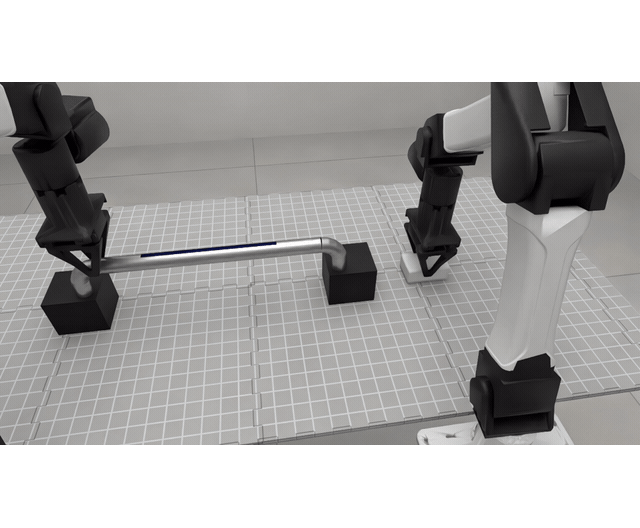

  <h1>
    
    Hi, I’m Kiki Huang
    
  </h1>
  <h3>Robotics Simulation Engineer</h3>
  

    Simulation Platforms · Dexterous Manipulation Simulation 
    Physics Solvers · World Models
  

  

    &nbsp;&nbsp;&nbsp;
    &nbsp;&nbsp;&nbsp;
    &nbsp;&nbsp;&nbsp;
    
  

  

    <a href="https://www.xiaohongshu.com/user/profile/62f72244000000001f0176ea">REDNOTE · 12K+ followers</a>
  

---

I’m a **Robotics Simulation Engineer at GENISOM AI in Beijing**, building platforms that bring together physics simulation, rendering, sensor models, and robot control. Previously, I worked on **production autonomous driving simulation for Baidu Apollo**.

My background is in **numerical modeling of physical systems**. I hold a master’s degree in Petroleum Engineering from China University of Petroleum, where I developed **physics-guided surrogate models for reservoir simulation**, using neural networks and mass-balance principles to predict how fluid distributions evolve over time.

I’m currently exploring **world models**, with a particular interest in how agents learn from physical interaction in tasks such as **dexterous manipulation**.

## Research Tools

<h3><a href="https://github.com/huangkiki/dailypaper-skills">DailyPaper Skills</a> </h3>

Agent skills for <strong>paper discovery, critical reviews, and connected research notes</strong>, with support for English and Chinese.

## Research & Engineering

### 1. Robot Simulation Platforms

<h3><a href="https://github.com/zsibot/matrix">MATRiX</a> </h3>

An integrated robotics simulation platform combining <strong>Unreal Engine 5 rendering and MuJoCo dynamics</strong>, configurable robot models, calibrated sensor simulation, motion control, and ROS 2-compatible communication for robot development and evaluation.

MATRiX · Town10 navigation

 

### 2. Dexterous Manipulation Simulation & Physics Solvers

<h3><a href="https://github.com/huangkiki/Dexlab">DexLab</a> </h3>

I develop **simulation workflows for dexterous manipulation**, covering robot and object modeling, task construction, controller integration, and behavior evaluation. DexLab brings these workflows together with reproducible experiments in **grasping, cutting, wiping, and deformable-material interaction**.

I use these tasks to examine how **contact, friction, and numerical solvers** affect simulated behavior, compare results across physics engines, and investigate tradeoffs between **numerical stability, accuracy, and computational cost**.

<table width="100%">
  <tr>
    <td width="50%" align="center" valign="top">
      
<strong><a href="https://huangkiki.github.io/Dexlab/en/latest/cut-push.html">Tofu cutting</a></strong>

      
    </td>
    <td width="50%" align="center" valign="top">
      
<strong><a href="https://huangkiki.github.io/Dexlab/en/latest/cut-push.html">Banana cutting</a></strong>

      
    </td>
  </tr>
  <tr>
    <td width="50%" align="center" valign="top">
      
<strong><a href="https://huangkiki.github.io/Dexlab/en/latest/rss-wiping.html">Stain wiping</a></strong>

      
    </td>
    <td width="50%" align="center" valign="top">
      
<strong><a href="https://huangkiki.github.io/Dexlab/en/latest/libero-workflow.html">LIBERO replay</a></strong>

      
    </td>
  </tr>
  <tr>
    <td colspan="2" align="center">
      
<strong><a href="https://huangkiki.github.io/Dexlab/en/latest/experiments.html#apple-replays">Apple grasping</a></strong>

      
    </td>
  </tr>
</table>

[More experiments](https://huangkiki.github.io/Dexlab/en/latest/experiments.html) · [Task and solver coverage](https://huangkiki.github.io/Dexlab/en/latest/coverage.html)

Recorded simulation replays · <a href="assets/projects/README.md">Sources and rendering details</a>.

### 3. World Model

<h3><a href="https://github.com/zsibot/gawm">GAWM: Geometry-Aware World Model</a> </h3>

Our action-conditioned JEPA world model combines latent prediction with <strong>state alignment (SA) and inverse dynamics (IDM) losses</strong>. <strong>SA trains a head to predict measured physical states from consecutive latent representations</strong>, encouraging the encoder to retain physical configuration and motion. IDM provides complementary supervision by predicting executed actions from latent pairs. Physical states are used only for training supervision. At deployment, GAWM plans toward visual goals with CEM in latent space, without reconstructing future images.

<strong>Toward Physically Grounded JEPA World Models for Goal-Conditioned Robotic Planning</strong> 
<em>Accepted to the IROS 2026 Workshop on Physical World Models for Scaling Embodied AI.</em> 
<a href="https://arxiv.org/abs/2609.03565">Paper</a> · <a href="https://github.com/zsibot/gawm">Code</a> · <a href="https://huggingface.co/kikihuang/GA-WM">Model Checkpoints</a>

 
GAWM model architecture · <a href="https://arxiv.org/html/2609.03565v2#S0.F1">Figure 1 from the paper</a>

---

I welcome discussions and collaboration on robotics simulation platforms, dexterous manipulation simulation, physics solvers, and world models.

[Project visuals](assets/projects/README.md)
