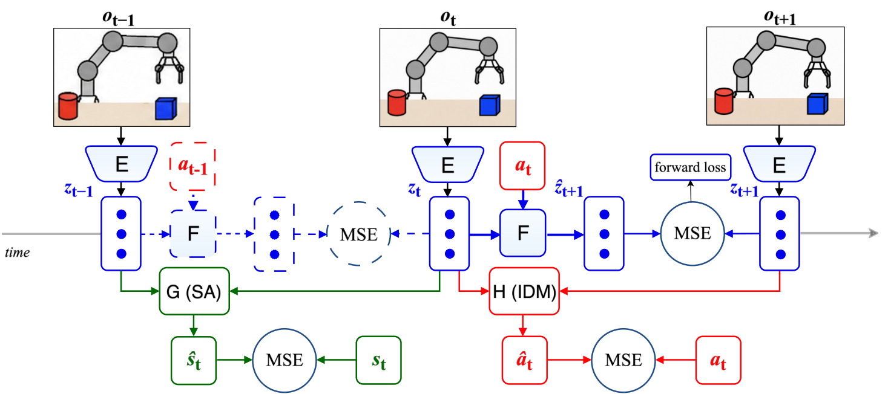

  <h1>
    
    Hi, I’m Kiki Huang
    
  </h1>
  <h3>Robotics Simulation Engineer</h3>
  

    Simulation Platforms · Dexterous Manipulation Simulation 
    Physics Solvers · World Models
  

  

    &nbsp;&nbsp;&nbsp;
    &nbsp;&nbsp;&nbsp;
    &nbsp;&nbsp;&nbsp;
    
  

  

    <a href="https://www.xiaohongshu.com/user/profile/62f72244000000001f0176ea">REDNOTE · 12K+ followers</a>
  

---

I build **simulation systems for robots**, with a broader interest in how agents **learn to understand and act in the physical world**. I currently develop robotics simulation platforms at a leading quadruped robotics company. Previously, I worked on **production autonomous driving simulation for Baidu Apollo**.

My engineering work connects **physics simulation and solvers, visual rendering, sensor models, and robot control** into closed-loop systems. I want to make these environments useful as **interactive sandboxes** where agents can explore, learn how the world responds, and test their understanding through action.

I’m exploring **predictive representation learning, including JEPA-based approaches**, with a focus on what an agent needs to represent to anticipate the consequences of its actions and plan effectively. **Dexterous manipulation** gives me a concrete way to study this: small differences in geometry, friction, or timing can change an outcome, even when two situations look similar.

My aim is to use **simulation as an experimental environment**: generate controlled interactions, test learned predictions through robot behavior, and use failures to refine both the world model and the environment. This lets me study how the design of a simulated world affects what an agent can learn within it.

My background is in **numerical modeling of physical systems**. I hold a master’s degree in Petroleum Engineering from China University of Petroleum, where I studied flow through porous media, numerical reservoir simulation, and physics-informed neural networks. Across subsurface flow, autonomous driving, and robotics, I keep coming back to how much of the physical world a model needs to capture, and how to tell when it is reliable enough to guide action.

## Research Tools

<h3><a href="https://github.com/huangkiki/dailypaper-skills">DailyPaper Skills</a> </h3>

Agent skills for <strong>paper discovery, critical reviews, and connected research notes</strong>, with support for English and Chinese.

## Research & Engineering

### 1. Robot Simulation Platforms

<h3><a href="https://github.com/zsibot/matrix">MATRiX</a> </h3>

An integrated robotics simulation platform combining <strong>Unreal Engine 5 rendering and MuJoCo dynamics</strong>, configurable robot models, calibrated sensor simulation, motion control, and ROS 2-compatible communication for robot development and evaluation.

MATRiX · Town10 navigation

 

### 2. Dexterous Manipulation Simulation & Physics Solvers

<h3><a href="https://github.com/huangkiki/Dexlab">DexLab</a> </h3>

Developing simulation workflows spanning **robot and object modeling, task construction, controller integration, and behavior evaluation**, alongside reproducible experiments on **contact, friction, deformable materials, and numerical solvers**. I explore grasping, in-hand manipulation, and cutting, with attention to numerical stability and tradeoffs between accuracy and efficiency.

The broader research matrix spans **MuJoCo, SuperDex, Genesis, Newton Physics, PhysX, and Drake**, with coverage varying by task. The previews below show recorded experiments; click an experiment for its report or an RTX preview for the full replay.

| Experiment | Animated preview | Result |
| --- | --- | --- |
| [RSS wiping](https://huangkiki.github.io/Dexlab/en/latest/rss-wiping.html) |  | Retains the sponge with auxiliary constraints; slips without them. Wiping reproduction. |
| [Cutting and pushing](https://huangkiki.github.io/Dexlab/en/latest/cut-push.html) |   | Blade contact pushes synthetic material; [separate single-cut force results do not establish convergence](https://huangkiki.github.io/Dexlab/en/latest/banana-force.html). |
| [Cross scoring](https://huangkiki.github.io/Dexlab/en/latest/tofu-scoring.html) |  | Two shallow cuts leave a connected base; the elastic surface can rebound. Native particle views remain available. |
| [Apple-stem grasp](https://huangkiki.github.io/Dexlab/en/latest/experiments.html#apple-replays) |  | Both 14 s MuJoCo 3.16 / SuperDex 1.0 records pass the 3 s hold check; scripted control. |
| [Cloth engine comparison](https://huangkiki.github.io/Dexlab/en/latest/cloth-comparison.html) |  | Historical cloth responses across four engines, retaining failures and coverage gaps. |
| [Robot cloth grasp](https://huangkiki.github.io/Dexlab/en/latest/experiments.html) |  | One development scene lifts, holds and releases; active folding remains unverified. |
| [Force-limit comparison](https://huangkiki.github.io/Dexlab/en/latest/visual-comparisons.html#pinch) |  | In the same Genesis protocol, actuator limits of 0.4 N slip and 0.8 N hold. |
| [LIBERO replay](https://huangkiki.github.io/Dexlab/en/latest/libero-workflow.html) |  | 500 official demonstrations: 495 task successes; none pass every numerical diagnostic. |
| [Six-engine incline](https://huangkiki.github.io/Dexlab/en/latest/visual-comparisons.html#incline) |  | Compare sliding responses across six engines; equal parameter values do not imply equivalent models. |
| [Normal contact calibration](https://huangkiki.github.io/Dexlab/en/latest/visual-comparisons.html#normal) |  | Loading fits a synthetic target better; unloading and transfer need separate validation. |

[Full task and solver matrix](https://huangkiki.github.io/Dexlab/en/latest/coverage.html) · [Experiment reports](https://huangkiki.github.io/Dexlab/en/latest/experiments.html) · [Historical PhysX apple recording](https://github.com/huangkiki/Dexlab/blob/b955d8536e219e7ba3de1150cfc19aa65878cfb3/demos/physx-contact/media/physx-sdf.mp4)

Lighting, surface reconstruction and recorded-state replay improve presentation. Original trajectories, failures and task scores are retained; appearance does not establish physical accuracy or an engine ranking. <a href="assets/projects/README.md">Visual sources and rendering details</a>.

### 3. JEPA & World Models

<h3><a href="https://github.com/zsibot/gawm">GAWM: Geometry-Aware World Model</a> </h3>

Our action-conditioned JEPA world model combines latent prediction with <strong>state alignment (SA) and inverse dynamics (IDM) losses</strong>. <strong>SA trains a head to predict measured physical states from consecutive latent representations</strong>, encouraging the encoder to retain physical configuration and motion. IDM provides complementary supervision by predicting executed actions from latent pairs. Physical states are used only for training supervision. At deployment, GAWM plans toward visual goals with CEM in latent space, without reconstructing future images.

<strong>Toward Physically Grounded JEPA World Models for Goal-Conditioned Robotic Planning</strong> 
<em>Accepted to the IROS 2026 Workshop on Physical World Models for Scaling Embodied AI.</em> 
<a href="https://arxiv.org/abs/2609.03565">Paper</a> · <a href="https://github.com/zsibot/gawm">Code</a> · <a href="https://huggingface.co/kikihuang/GA-WM">Model Checkpoints</a>

 
GAWM model architecture · <a href="https://arxiv.org/html/2609.03565v2#S0.F1">Figure 1 from the paper</a>

---

I welcome discussions and collaboration on robotics simulation platforms, dexterous manipulation simulation, physics solvers, and world models.

[Project visuals](assets/projects/README.md)
